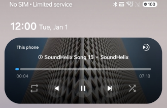
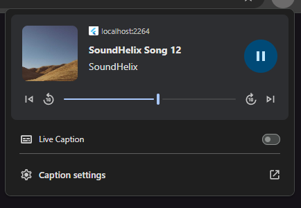
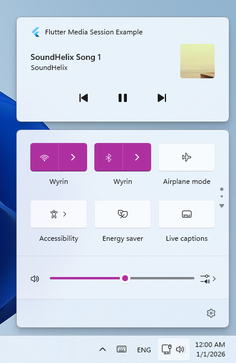

<div align="center">
    
</div>

# flutter_media_session

[](https://pub.dev/packages/flutter_media_session)
[](https://pub.dev/packages/flutter_media_session/score)
[](https://github.com/wyrindev/flutter-media-session/actions/workflows/ci.yml)
[](LICENSE)
[](https://pub.dev/packages/flutter_media_session)

A Flutter plugin that connects media playback to OS media hubs — Android notifications, iOS Lock Screen & Dynamic Island, macOS Control Center, Windows SMTC, and the Web Media Session API.

The plugin handles metadata and remote command routing only. It does not include an audio engine; you bring your own player (`just_audio`, `media_kit`, `audioplayers`, etc.) and wire it in via an adapter.

## Features

- **Cross-platform OS integration** — Android media notifications (Media3), iOS/macOS Lock Screen & Now Playing, Windows SMTC volume flyout, and Web MediaSession API, all from a single Dart API.
- **Adapter pattern** — drop in a ready-made adapter for `just_audio` or `media_kit` and metadata / playback state sync is handled automatically.
- **Configurable action slots** — control which transport buttons appear in Android notifications via `ActionSlotLayout`, including custom actions with your own icons.
- **Remote command routing** — receive play, pause, seek, skip, shuffle, and repeat commands from lock screens, headsets, and system media hubs through a unified callback interface.
- **Background keep-alive** — optionally acquire a wake lock to sustain playback while the app is backgrounded.

<div align="center">
  <table>
    <tr>
      <td align="center"><b>Android</b></td>
      <td align="center"><b>Web (Chrome)</b></td>
      <td align="center"><b>Windows 11</b></td>
    </tr>
    <tr>
      <td></td>
      <td></td>
      <td></td>
    </tr>
  </table>
</div>

## Platform Support

| Platform | Minimum Version |
| :--- | :--- |
|  Android | Android 7.0 (API 24+) |
|  iOS | iOS 12.0+ |
|  macOS | macOS 10.15+ |
|  Windows | Windows 10 1809+ (Build 17763+) |
| Web | Modern Browsers |
|  Linux | Planned (MPRIS) |

> For architecture and native backend details (Media3, MediaPlayer, SMTC), see the [Architecture Guide](doc/architecture.md).

## Installation

Run this command:

```bash
flutter pub add flutter_media_session
```

Or add `flutter_media_session` manually to your `pubspec.yaml`:

```yaml
dependencies:
  flutter_media_session: ^3.1.0
```

> Full documentation, tutorials, and setup guides are available at **[docs.wyrin.dev/flutter-media-session](https://docs.wyrin.dev/flutter-media-session)**.

## Platform Prerequisites

### iOS

To keep media controls responsive and receive remote commands while your application is backgrounded, add `UIBackgroundModes` with `audio` to `ios/Runner/Info.plist`:

```xml
<key>UIBackgroundModes</key>
<array>
    <string>audio</string>
</array>
```

> **Note**: While the plugin configures `AVAudioSession` category to `.playback` upon activation, iOS background execution relies on the application actively playing audio through an audio session.

### Android

- **Permissions**: Core permissions (`FOREGROUND_SERVICE`, `FOREGROUND_SERVICE_MEDIA_PLAYBACK`, `FOREGROUND_SERVICE_CONNECTED_DEVICE`, `POST_NOTIFICATIONS`, `WAKE_LOCK`, and `ACCESS_WIFI_STATE`) are declared in the plugin's `AndroidManifest.xml` and merged automatically by Gradle. (To strip unused casting permissions, see [Opting Out of Permissions](doc/usage.md#opting-out-of-android-permissions).)
- **Android 13+ (API 33+)**: Notification posting requires runtime permission. Calling `FlutterMediaSession().activate()` automatically requests notification permission on Android.
- **Custom Icons**: Custom notification action drawables must exist in your application's `android/app/src/main/res/drawable*` folders.

### Windows

- **Packaged Apps (MSIX)**: When packaged via MSIX, Windows assigns the App User Model ID (AUMID) automatically from the manifest. No configuration required.
- **Unpackaged / Portable Apps**: To display your application's name and icon instead of "Unknown Application" in the volume flyout, refer to the [Windows Setup Guide](doc/windows_setup.md).

### macOS & Web

No configuration required.

## Quick Start

### Approach A: Using a Player Adapter (Recommended)

Adapters handle the stream subscriptions and state mapping between your player and the media session. Ready-to-use adapter guides are available on the [Documentation site](https://docs.wyrin.dev/flutter-media-session) and in `doc/adapters/`:

```dart
import 'package:flutter_media_session/flutter_media_session.dart';
import 'package:just_audio/just_audio.dart';
// Import your adapter implementation (see doc/adapters/just_audio.md)
import 'just_audio_media_session_adapter.dart';

final player = AudioPlayer();
final session = FlutterMediaSession();

// 1. Activate session (starts Android foreground service, binds SMTC / NowPlaying)
await session.activate();

// 2. Bind adapter to automatically synchronize metadata, playback states, and commands
session.bind(JustAudioMediaSessionAdapter(player));
```

### Approach B: Direct API Usage

You can also push metadata and playback states manually, and receive system actions via high-level callbacks or streams:

```dart
import 'package:flutter_media_session/flutter_media_session.dart';

final session = FlutterMediaSession();

// 1. Activate native session
await session.activate();

// 2. Update media metadata
await FlutterMediaSessionPlatform.instance.updateMetadata(
  const MediaMetadata(
    title: 'Song Title',
    artist: 'Artist Name',
    album: 'Album Title',
    artworkUri: 'https://example.com/cover.jpg',
    duration: Duration(minutes: 3, seconds: 30),
  ),
);

// 3. Update playback state
await FlutterMediaSessionPlatform.instance.updatePlaybackState(
  const PlaybackState(
    status: PlaybackStatus.playing,
    position: Duration(seconds: 45),
    speed: 1.0,
  ),
);

// 4. Handle incoming system media actions
session.setActionHandler(
  onPlay: () => myAudioPlayer.resume(),
  onPause: () => myAudioPlayer.pause(),
  onSeekTo: (position) => myAudioPlayer.seek(position),
  onSkipToNext: () => myPlaylist.next(),
  onSkipToPrevious: () => myPlaylist.previous(),
);
```

## Documentation

For full documentation, guides, and tutorials, visit:

👉 **[docs.wyrin.dev/flutter-media-session](https://docs.wyrin.dev/flutter-media-session)**

For offline reference, local documentation is also included in the repository:
- **[Usage Guide](doc/usage.md)**: API reference, writing custom adapters, Android notification layouts (`ActionSlotLayout`), audio interruption handling, and background keep-alive.
- **[Player Adapter Guides](https://docs.wyrin.dev/flutter-media-session/adapters/just_audio)**:
  - **[`just_audio` Adapter](doc/adapters/just_audio.md)**
  - **[`media_kit` Adapter](doc/adapters/media_kit.md)**
- **[Windows Setup Guide](doc/windows_setup.md)**: Resolving the "Unknown Application" display name issue via MSIX or shortcut registration.
- **[Architecture & Design Decisions](doc/architecture.md)**: Platform internals, foreground service lifecycle, and native thread dispatching.
- **[Release Guide](doc/release.md)**: Release verification and CI publishing workflow.